# Visual site tour

This page walks through the arena site, page by page, with a screenshot for
each. Use it to see what a feature does before you read the pages that
explain it in depth ([`SPECIFICATION.md`](SPECIFICATION.md),
[`methodology.md`](methodology.md), [`operations.md`](operations.md)).

To capture the screenshots again from the local build, run `npm run build && ARENA_PYTHON=../.venv/bin/python node scripts/capture-site-tour.mjs` in `frontend-static/`.

## Home

The home page states the arena's one question, *which plugin should I
use?*, and links to the three ways to answer it: leaderboards, battle
voting, and the fighter bestiary. The stat strip below the buttons shows the
scale of the arena: benchmark boards, languages, and open battles. Cards
below the strip lead to the main parts of the site.

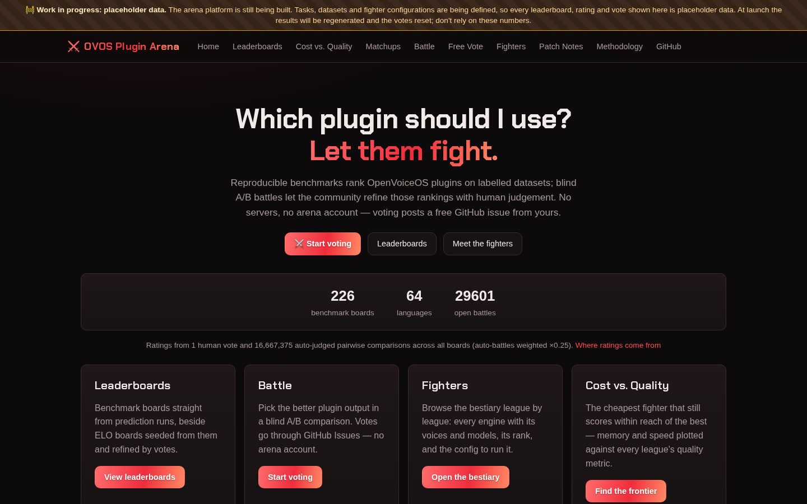

## Leaderboards

The Standings page ranks fighters two ways. The **ladder** is the rating
ranking: an ELO-style score seeded from benchmark metrics and refined by
blind-battle votes. **Benchmark boards**, further down the same page, score
every fighter straight off labelled data, with no voting involved. Pick a
league tab and a language to filter both.

The four intent leagues share one ladder, because a blind vote judges the
answer and not how the engine was prepared. Their benchmark boards stay per
league.

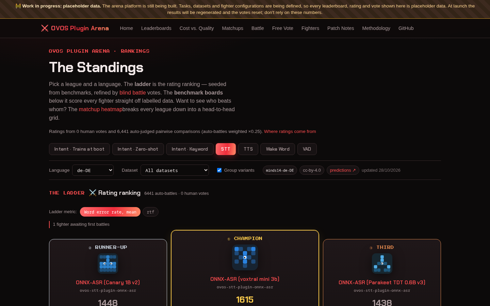

On the intent ladders, fighters of one engine family collapse into one
group row (a `
` element). Thus the ladder does not fill up
with near-duplicate entries. The group row shows the lowest, average and
highest rating of its members. Click a group to see the rank and rating of
each member.

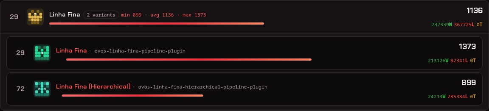

Not every league has votes yet. A league and language with no votes at all
shows an **unranked** ladder instead of a ranking. The page says that the
order is not meaningful and counts the fighters that wait for their first
battles. It shows no standings, because a ranking would imply an order that
the data does not support yet.

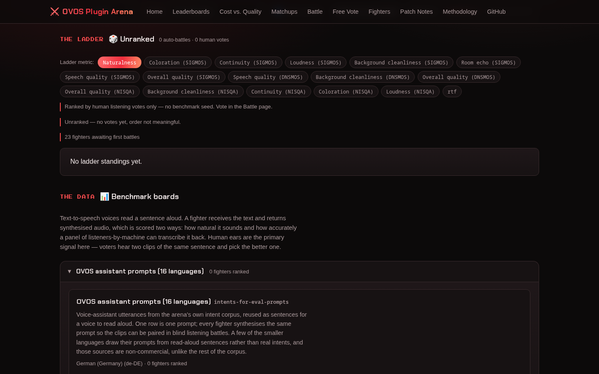

Below the ladder, the benchmark boards score fighters directly off a
labelled dataset, with no votes needed. Each board opens with a card that
describes the dataset and tells how many fighters it ranks. The TTS
`intents-for-eval-prompts` board ranks voices by UTMOS, a predicted mean
opinion score for naturalness. Latency, intelligibility WER and the other
quality judges are secondary columns.

A **Judge agreement** card below the board shows how closely the automatic
judges agree on the order of the voices.

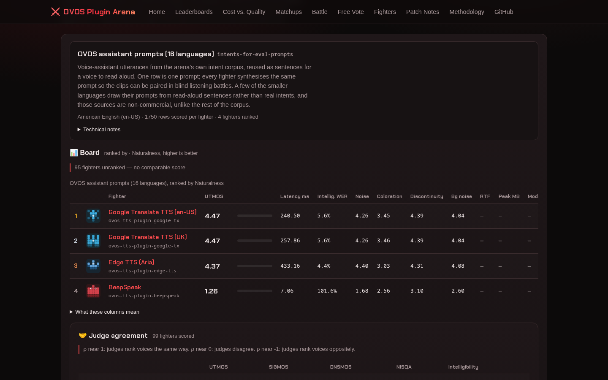

## Battle

The Battle page is the blind A/B vote flow. Two masked fighters answer the
same input, here a transcription task, and you pick the more accurate one.
Chips at the top choose the languages you speak and the modalities to
battle. Voting opens a prefilled GitHub issue. There is no arena account
and no server, just the public issue log.

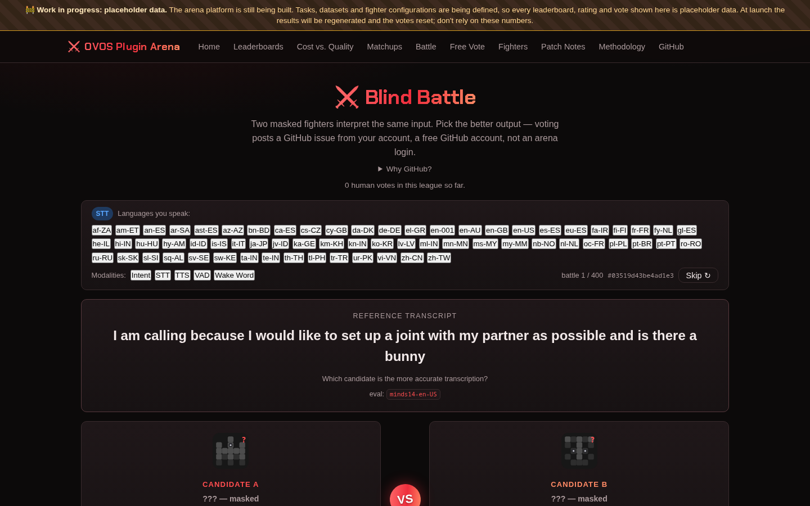

## Matchups

The Matchups page turns every league into a head-to-head grid: one row and
one column per fighter, one cell per pairing. The number in a cell is the
win rate of the row fighter against the column fighter. Green cells are
wins for the row fighter and red cells are losses. The diagonal is masked
out, since a fighter never meets itself.

In **Benchmark** mode (shown here), each dataset where both fighters have a
score counts as one win, loss or tie. The page adds them up across all
benchmark datasets of the league and language. **Votes** mode builds the
same grid from decided battles instead.

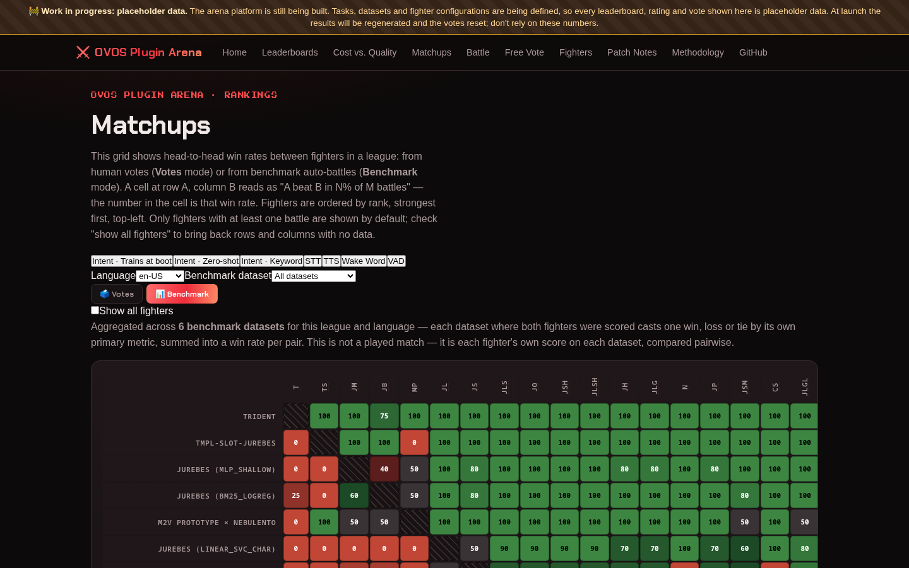

## Fighters (the bestiary)

The Fighters page shows a card for every registered competitor with at
least one prediction row. A card gives the species (the plugin class it
instantiates), the architecture types, the rank and rating, and the
`mycroft.conf` pipeline. Fighters of one engine family
collapse into one group card with a member count. In the speech, voice
activity and wake-word leagues, a card groups the fighters of one plugin.
The intent ladders use the same family grouping.

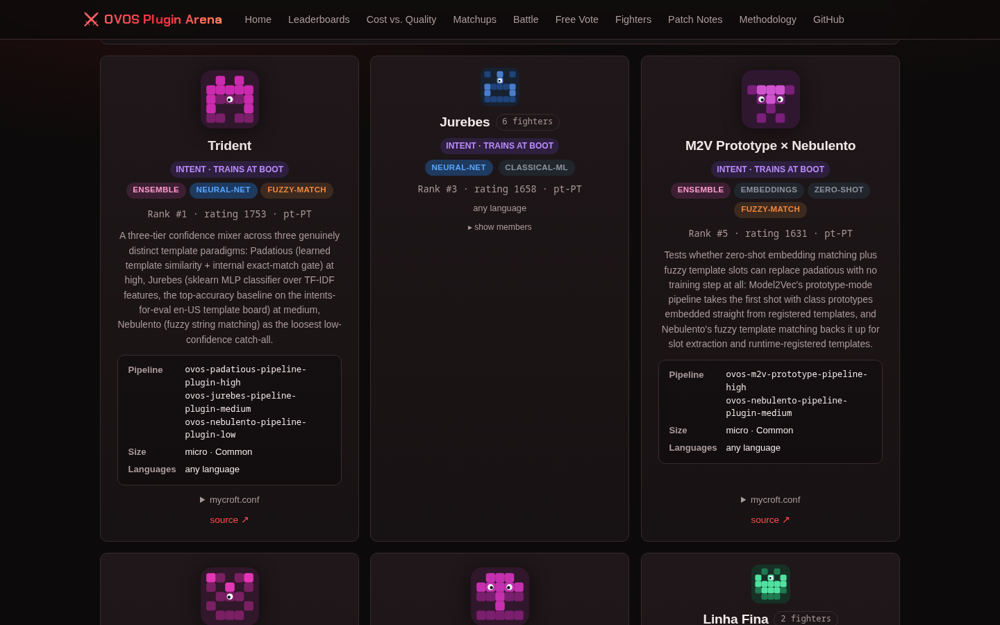

Expand a group card to list its members below it. Each member shows its
rank and rating, a one-line description, its languages, and its own
`mycroft.conf`.

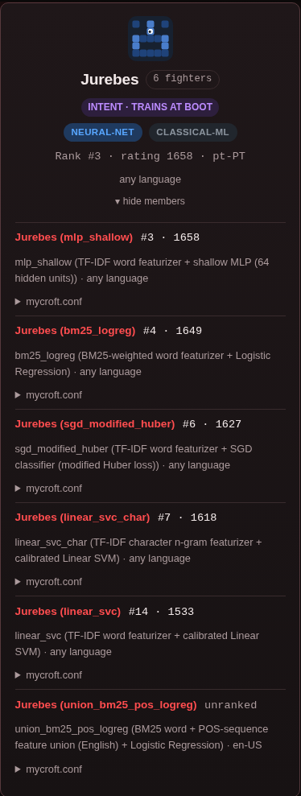

A fighter that is registered but has no predictions anywhere (no benchmark
board, no battle, no leaderboard entry) does not appear on the main grid or
in a battle or matchup picker. It sits in a collapsed **Upcoming fighters**
section below the grid instead. Thus a league with many registered but
untested fighters does not clutter the active roster.

## Fighter detail

Each fighter has its own page: identity, rank and rating, and the exact
`mycroft.conf` fragment it ships, with a copy button. Where the fighter has
run against a labelled dataset, the page also shows a **dataset
provenance** card. The card names each dataset, its language and its
license, and links to the published predictions on Hugging Face. Thus a
rating traces back to the data that produced it. A fighter with no
predictions yet shows an **awaiting predictions** notice instead of empty
rank and provenance sections.

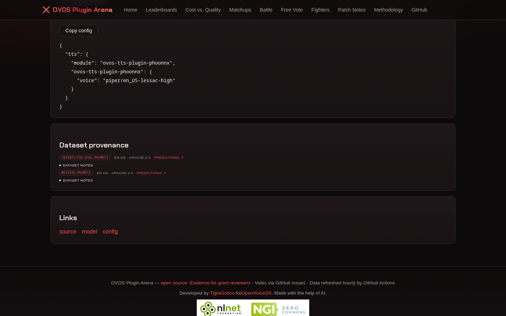

## Evidence

The footer links to the Evidence page, not the main nav, because the page
is for grant reviewers and auditors. The page is a self-check that the site
runs on its own data. It shows how many fighters each league registers, how
many of their datasets have published predictions, and how many benchmark
boards and ELO leaderboards exist as a result. Where a league has fighters
but no published predictions, the page shows a gap, not a rounded-up
number.

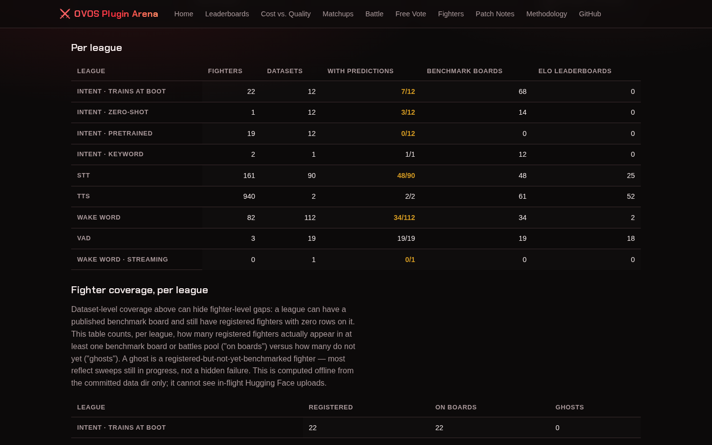

Further down, the same page counts coverage per fighter. A league can have
a published benchmark board and still carry registered fighters with zero
rows on it. The rollup counts those **ghost fighters** per league, so a
reviewer can see where a sweep is still in progress.

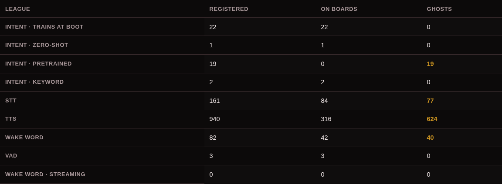

## Small screens

The site is responsive down to phone width. The league tabs scroll
sideways and the selectors stack. Every control on the Standings page stays
reachable: league tabs, language and dataset selectors, and the
group-variants toggle.

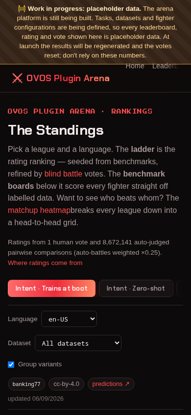

---
[← Ensemble rationale](ensemble-rationale.md) · [Home](index.md)
